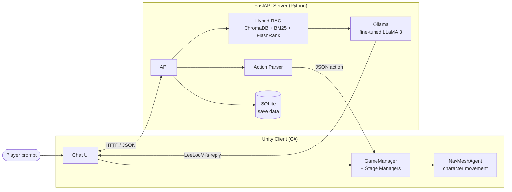

# The Beta

**An AI-prompt escape game** — you play as an AI assistant and guide a trapped student, *LeeLooMi*, out of a locked-down campus using nothing but natural-language prompts.

2026 Capstone Design project · Team **AIming** · Sungshin Women's University

  
   
  ▶ Click to watch the full gameplay demo on YouTube

> 📦 **Source code:** [AIming-sswu/ai-prompt-escape-game](https://github.com/AIming-sswu/ai-prompt-escape-game)
> This repository is a showcase of the project and my contributions to it. The full source lives in the team repository above.

---

## About the Game

It's the year 2525 at Alpha University. The campus AI system, **Beta**, has gone down, and the power is out.
LeeLooMi, a cyborg student, is stuck inside — and **you are her AI assistant**.

You can't press buttons or walk for her. You can only **type prompts**.
A local LLM reads your instructions, replies in LeeLooMi's own voice, and turns them into real in-game actions.
Vague prompts get you a grumpy, confused LeeLooMi; clear ones get you through the puzzles.

The game is designed to teach **effective prompting** through play.

## Highlights

- **Natural language → in-game action** — player prompts are parsed on the server into structured JSON actions, which the Unity client executes with `NavMeshAgent` movement
- **Fine-tuned character persona** — LLaMA 3 8B fine-tuned on a custom dataset to give LeeLooMi a prickly-but-friendly speaking style
- **Hybrid RAG** — ChromaDB (semantic) + BM25 (keyword) + FlashRank (reranking) retrieve game-state-aware context to reduce hallucination
- **Multi-spectrum investigation** — IR / UV / thermal vision modes filter what context the LLM can see, so each mode reveals different clues
- **Affection system** — LeeLooMi's mood toward the player changes based on how well you guide her
- **Fully local** — runs offline with Ollama, no cloud API

## Architecture

## My Role — Team Lead · Client · AI

I led the team of four and worked across the Unity client, game design, and the LLM's character data.

### Unity client & game design
- Designed and implemented the **client UI/UX** — title screen, settings, in-game chat window, item panel, chat bubbles
- **Map design** and asset placement for every stage, from the prologue classroom up to the server room
- Game scene direction and **LeeLooMi's animations**
- Wrote the **game scenario** and designed the **puzzle mechanics**
- Implemented the **affection system** that reacts to the player's guidance

### LLM fine-tuning & data
- Built the **fine-tuning dataset (JSONL)** focused purely on LeeLooMi's tone and small talk, kept separate from puzzle answers
- Wrote a **data-augmentation script** that uses a local LLM to generate new training samples from a spoiler-free world setting, sampling across 7 story situations (blackout, power restored, sneaking past drones, puzzle failure / success, …) to avoid biased data
- Fine-tuned LLaMA 3 and tested the fused model
- Maintained the **RAG world-data file** (`game_data`) through many revisions as the scenario evolved

## Challenges & Lessons Learned

Putting a live LLM inside an NPC turned out to be the hardest part of the project.
**Conversations with LeeLooMi are not always smooth** — an 8B model running locally sometimes misreads instructions, drifts out of character, or answers off-topic. These are the problems we hit and what we did about them.

| Problem | Cause | What we did |
|---|---|---|
| Asking *"Who are you?"* returned unrelated lore | Chunks were too large, every query was treated the same way, and a bug left the vector store empty even though the documents were split correctly | Switched to line-level chunking, added a query-type router (`classify_query()`), injected identity context directly, and rebuilt the ChromaDB store |
| The model ignored parts of long prompts | A small fine-tuned model struggles with long context | Rewrote the system prompt to be shorter and more directive |
| Fine-tuning data leaked puzzle answers | Training data mixed tone examples with game solutions | Restricted the dataset to tone and small talk only, and generated extra samples from a spoiler-free world setting |
| Augmented data risked being biased toward a few situations | Without guidance, the generator kept producing similar scenes | Sampled across 7 distinct story situations during augmentation |

**What I'd do next:** evaluate dialogue quality with a fixed test set instead of manual play-testing, constrain outputs more strictly (e.g. structured output for actions), and compare against a larger model to separate model limits from data limits.

## Team AIming

| Member | Role |
|---|---|
| **Sieun Hwang** (me) | Team lead · Unity client · scenario & puzzles · fine-tuning |
| 권유진 | 2D pixel art for characters & objects · ending scene · fine-tuning data |
| 정소영 | FastAPI server · RAG pipeline · prompt engineering · fine-tuning data |
| 윤지원 | FastAPI server · action parser · NavMesh & stage setup · fine-tuning |

## Tech Stack

| Area | Stack |
|---|---|
| Client | Unity 6 (6000.3.10f1), C# |
| Server | Python 3.12, FastAPI, SQLite, SQLAlchemy |
| AI | Ollama, LLaMA 3 8B (fine-tuned), LangChain, ChromaDB, BM25, FlashRank, nomic-embed-text |
| Art | Aseprite, Photoshop |
| Platform | Windows |
